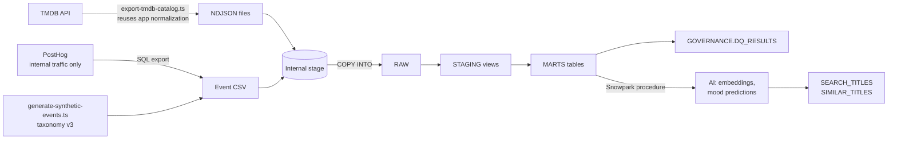

# PickTonight Snowflake warehouse

This folder holds a small analytics and ML warehouse for PickTonight, built on
Snowflake. It loads the TMDB catalog and PickTonight's analytics events and
models them in layers. Snowpark Python then trains two models inside
Snowflake:

- **Title embeddings.** These power "more like this" and free-text search with
  Snowflake's native `VECTOR` type.
- **A mood classifier.** It tests how well a title's own text supports the
  app's genre-based mood rules.

The live app does not depend on any of this. The warehouse is an offline
companion for analysis and model experiments.



## Layers

| Schema       | What it holds                                                                                                                                                    |
| ------------ | ---------------------------------------------------------------------------------------------------------------------------------------------------------------- |
| `RAW`        | Exact copies of the uploaded files, plus `source_file`, `source_row`, and `loaded_at` lineage columns                                                            |
| `STAGING`    | Views that cast types and flatten JSON. No business logic                                                                                                        |
| `MARTS`      | `DIM_TITLE`, `BRIDGE_TITLE_GENRE`, `TITLE_RULE_MOODS`, `FCT_EVENTS`, `FCT_RECOMMENDATION_JOURNEYS`, `AGG_PICKER_FUNNEL_DAILY`, `AGG_MOOD_OUTCOMES`               |
| `AI`         | `TITLE_EMBEDDINGS`, `MOOD_MODEL_METRICS`, `TITLE_MOODS_PREDICTED`, `SIMILAR_TITLES`, `SEARCH_EVAL`, the `EMBED_TEXT` UDF, and the `SEARCH_TITLES` table function |
| `GOVERNANCE` | Data quality results, masking policies, and sensitivity tags                                                                                                     |

## Data sources and privacy

- **TMDB catalog.** `npm run warehouse:export-catalog` calls TMDB through the
  app's own server-side client. It then runs every result through the same
  strict `MediaSummary` normalization the recommendation engine uses. Records
  that fail the contract are counted in `extract-report.json` and skipped,
  never repaired. The default snapshot reads the 50 most popular pages per
  media type, limited to titles with at least 100 votes. TMDB's popularity
  paging repeats some titles across pages, so the export keeps each title's
  first appearance. The October 2026 snapshot kept 1,652 unique titles (835
  movies and 817 TV series) out of 2,000 results, with 0 records rejected.
- **Real events.** Only events with `traffic_class = internal` are exported
  from PostHog. Pilot participant data stays in PostHog.
- **Synthetic events.** `npm run warehouse:synthetic-events` generates seeded
  journeys that follow [taxonomy v3](../docs/event-taxonomy.md) exactly. Their
  `distinct_id` starts with `synthetic-`. The warehouse also derives a
  `data_origin` column from the file name, so synthetic rows can always be
  filtered out.
- **Local files.** Everything is written to `warehouse/data/`, which is
  gitignored. TMDB data and event exports are never committed.
- **Checks.** `04_data_quality.sql` enforces the analytics property allowlist
  again inside the warehouse. It fails if any event carries a property
  outside the reviewed taxonomy, or if the real export contains participant
  traffic.

## Models

Snowflake trial accounts block Cortex AI functions (`AI_EMBED`, `AI_CLASSIFY`)
and Cortex Search. Both models therefore run as scikit-learn inside a Snowpark
Python stored procedure, on the project warehouse.

**Title embeddings (latent semantic analysis).** Each title's search document
is its name, type, year, genres, and overview. TF-IDF over unigrams and
bigrams is reduced to 128 dimensions with truncated SVD and scaled to unit
length. The vectors are stored as `VECTOR(FLOAT, 128)`. `AI.EMBED_TEXT` loads
the same fitted pipeline from a stage, so a free-text query lands in the same
space. `VECTOR_COSINE_SIMILARITY` then ranks the titles. These are classic LSA
embeddings, not neural ones. They capture shared vocabulary and themes, not
deep meaning.

**Weakly supervised mood classifier.** `src/server/mood-mapping.ts` maps moods
to TMDB genres. The procedure turns those rules into labels: a title is
"spooked" if it has a spooked genre for its media type. A one-vs-rest
logistic regression then learns those labels from the **title and overview
only**. Genres are left out of the features so the model cannot copy the
rule. Every title is scored by a model trained on the other four folds of a
5-fold split. Precision and recall therefore show how much mood signal the
text itself carries. Titles where that out-of-fold prediction is confident and
the rule disagrees are saved in `TITLE_MOODS_PREDICTED`. They are candidates
where a genre is a poor proxy for mood. "Surprised" is a discovery mood with no genre rule, so it is not
modeled.

`AI.SEARCH_EVAL` gives search a repeatable relevance check. It runs plot
descriptions that never name their genre, such as "a ghost haunts a family
after they move into an old house", and measures how many of the top ten
movies carry the expected TMDB genre.

## Run it

You need a Snowflake account (a trial works, Enterprise edition for masking
policies), the repo's `.env` with `TMDB_API_READ_TOKEN`, and optionally the
PostHog internal-traffic export.

1. **Test the extract code.**
   ```bash
   npm run test:warehouse
   ```
2. **Export the catalog and generate events.**
   ```bash
   npm run warehouse:export-catalog
   npm run warehouse:synthetic-events
   ```
   Optionally, add the PostHog export as
   `warehouse/data/posthog_internal_events.csv`, with columns
   `uuid,event,timestamp,distinct_id,properties` from this PostHog SQL query:
   ```sql
   SELECT uuid, event, timestamp, distinct_id, properties
   FROM events
   WHERE properties.traffic_class = 'internal'
     AND properties.taxonomy_version = 3
   ORDER BY timestamp
   ```
3. **Set up Snowflake.** In Snowsight, open each file in
   `warehouse/snowflake/` as a SQL file. Run it with **Run All** from the menu
   next to the Run button, in order. Start with `00_setup.sql`.
4. **Upload the files.** Go to Data, then `PICKTONIGHT` → `RAW` → Stages →
   `PICKTONIGHT_STAGE`, and click **+ Files**. Upload everything in
   `warehouse/data/` except `extract-report.json`, plus
   `warehouse/snowpark/title_models.py`.
5. **Run the rest in order.**

   | File                   | What it does                                                       |
   | ---------------------- | ------------------------------------------------------------------ |
   | `01_load_raw.sql`      | `COPY INTO` each RAW table, then row counts per file               |
   | `02_staging.sql`       | Typed views                                                        |
   | `03_marts.sql`         | Dimension, fact, and aggregate tables                              |
   | `04_data_quality.sql`  | 14 checks, saved to `GOVERNANCE.DQ_RESULTS`                        |
   | `05_snowpark_ml.sql`   | Trains both models, creates `AI.EMBED_TEXT`                        |
   | `06_vector_search.sql` | Similar titles, `AI.SEARCH_TITLES`, and the search evaluation      |
   | `07_governance.sql`    | Roles, masking policies, tags, and an analyst-versus-engineer test |
   | `08_cost.sql`          | Time and credits per step, then suspends the warehouse             |

Rerunning is safe. Loads truncate and reload, and tables use
`CREATE OR REPLACE`. After rerunning `03_marts.sql`, also rerun
`07_governance.sql`, because rebuilding a table drops its masking policies.

### Optional: test the model code locally

```bash
python3 -m unittest discover -s warehouse/snowpark -v
```

This needs `scikit-learn` and `numpy`. The tests cover the
embedding and classifier logic without a Snowflake connection.

## Governance

- `PICKTONIGHT_ENGINEER` reads every layer and sees real identifiers.
- `PICKTONIGHT_ANALYST` reads only `MARTS` and `AI`. For this role,
  `distinct_id`, `session_id`, `recommendation_session_id`, and
  `recommendation_item_id` are replaced by a stable SHA-256 prefix. Counts and
  joins still work. The same IDs are stripped from the `properties` JSON.
- Masked columns carry the `DATA_SENSITIVITY = 'pseudonymous_id'` tag.

## Cost

The warehouse is `XSMALL` with a 60-second auto-suspend. It is capped by a
20-credit monthly resource monitor that suspends it at 100 percent. Every
script sets a `QUERY_TAG`, so `08_cost.sql` reports time and data scanned per
pipeline step.

## Results from the first full run

These numbers come from the October 26, 2026 run on a Snowflake trial account
(Enterprise edition, `XSMALL` warehouse).

**Loading and quality**

- 1,652 unique titles (835 movies, 817 TV series) from 2,000 TMDB results, with
  0 records rejected by the `MediaSummary` contract.
- 5,225 events: 100 real internal-traffic events from PostHog and 5,125
  synthetic events from 600 simulated sessions.
- All 14 data quality and privacy checks pass. On the first run the property
  allowlist check failed on every PostHog row. It found `$sent_at`, a send
  timestamp the PostHog SDK stores on each event, which the documented
  allowlist did not mention. The check now allows that one transport field
  and still fails on any other `$` property.

**Embeddings and search**

- 128-dimension LSA embeddings over a 7,629-term vocabulary. The 128
  dimensions keep 24 percent of the TF-IDF variance.
- Mean genre precision@10 of **0.68** across the 8 test queries. Romance and
  Science Fiction scored 1.00, Action 0.90, Crime 0.70, Comedy 0.60, Horror
  0.50, Animation 0.40, and War 0.30.
- The War query shows the main weakness: "soldiers fight to survive" also
  matches survival films such as Train to Busan, because the embeddings match
  words rather than meaning.

**Mood classifier**

- Micro F1 of **0.652** with 5-fold cross-validation. Per-mood F1 ranged from
  0.58 for "spooked" to 0.76 for "excited".
- Out-of-fold probabilities stayed between about 0.15 and 0.86. With cutoffs
  of 0.7 and 0.3, 67 title and mood pairs were flagged for review. Examples
  include Prometheus, whose plot reads as "excited" although its genres map
  only to "spooked", and Star Trek: The Next Generation, tagged "spooked" only
  because of its Mystery genre.

**Governance and cost**

- The analyst role sees `masked_` hashes for every identifier, the engineer
  role sees real values, and both count the same 615 distinct sessions.
- The whole pipeline, including repeated training runs while debugging, used
  about 0.50 warehouse credits. Snowpark training and vector search were the
  slowest steps.

## Limits

- LSA embeddings match shared words and themes. A neural embedding model
  would understand paraphrases better. If Cortex is available on the account,
  `AI_EMBED` and Cortex Search are the natural next step.
- Mood labels come from genre rules, so the classifier measures agreement with
  those rules. It does not measure true viewer mood.
- Synthetic events show that the models and checks work. They are not
  evidence about real user behavior.
